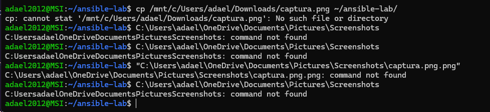

# Ansible Lab con Docker

## Objetivo de la práctica
Automatizar la configuración de dos servidores simulados con contenedores Docker (Ubuntu 24.04) usando Ansible: inventario, conexión mediante el plugin `docker`, y un playbook que muestra información del sistema, crea directorios y archivos, usa `loop` y condicionales (`when`).

## Requisitos
- Docker y Docker Compose
- Ansible (con la colección `community.docker`: `ansible-galaxy collection install community.docker`)

## Comandos para iniciar los contenedores
```bash
docker compose up -d
docker ps

# Instalar Python en cada contenedor
docker exec server1 bash -c "apt update && apt install -y python3"
docker exec server2 bash -c "apt update && apt install -y python3"
```

## Comprobar la conexión
```bash
ansible docker -i inventory.ini -m ping
```

## Comando para ejecutar el playbook
```bash
ansible-playbook -i inventory.ini playbook.yml
```

## Captura de la ejecución exitosa


> Reemplaza `captura.png` con tu captura real y súbela al repositorio.

## Estructura
```text
ansible-lab/
├── docker-compose.yml
├── inventory.ini
├── playbook.yml
└── README.md
```
